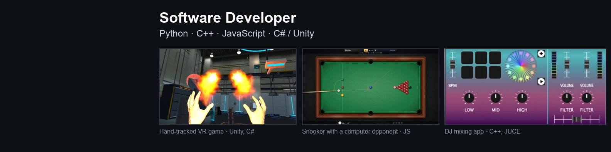
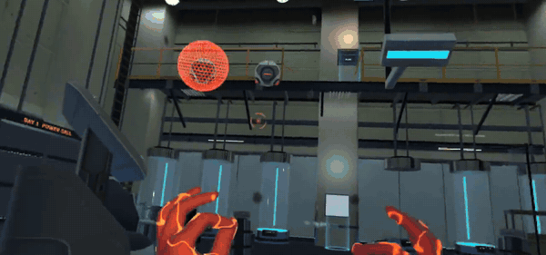
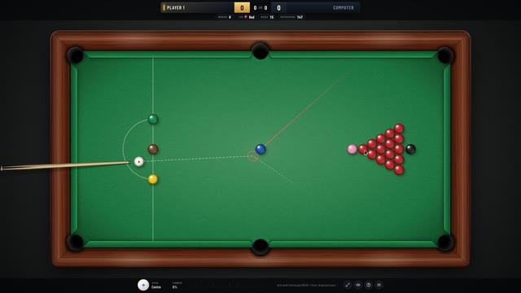
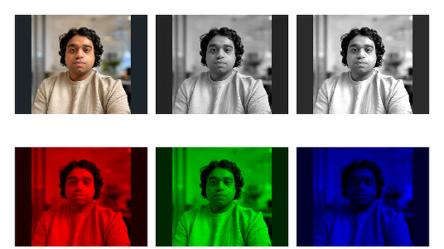
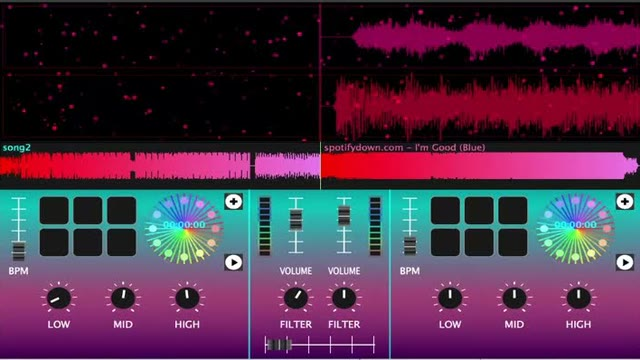
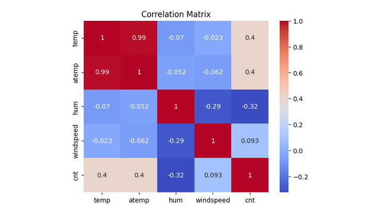

# Muhammad Dawood

Final-year BSc Computer Science student at the University of London (graduating 2027), based in Greater Manchester and looking for graduate and junior software developer roles.

The problems I enjoy most are the ones where you can see or hear when the code is wrong: a collision that looks off, audio that clicks, a gesture that fires twice.

## Now building: a hand-tracked VR game

A Meta Quest game played with bare hands, no controllers: pinch to charge and throw fire, thrust an open palm to Force Push, hold a palm up to phase-step. Most of the work is in the gesture recognition, reading palm direction and hand speed so a power fires when you mean it and stays quiet when you don't. Unity, C#, OpenXR and XR Hands.

The code is private while the game is in development. **[Watch the Chapter One reel on LinkedIn](https://www.linkedin.com/feed/update/urn:li:activity:7523352457809235969/)**

## Projects

<table>
  <tr>
    <td width="50%" valign="top">
      
       <b>Snooker</b> · <a href="https://dawood2k1.github.io/snooker-game/">play it</a> · <a href="https://github.com/Dawood2k1/snooker-game">code</a>
       Browser snooker with spin, full rules, an aiming guide and a computer opponent at three skill levels.
       JavaScript · p5.js · Matter.js
    </td>
    <td width="50%" valign="top">
      
       <b>Webcam image processing</b> · <a href="https://dawood2k1.github.io/webcam-image-processing/">try it</a> · <a href="https://youtu.be/ZBYLMcER8F8">video</a> · <a href="https://github.com/Dawood2k1/webcam-image-processing">code</a>
       Live webcam filters written pixel by pixel: colour channels, thresholding, YCbCr and HSV segmentation, and face detection driving blur and pixelation.
       JavaScript · p5.js
    </td>
  </tr>
  <tr>
    <td width="50%" valign="top">
      
       <b>DJ mixing app</b> · <a href="https://youtu.be/Yy76vANARSc">video</a>
       Two decks with a crossfader, cue pads, jog wheels, three-band EQ, filters, waveforms and a searchable music library.
       C++ · JUCE
    </td>
    <td width="50%" valign="top">
      
       <b>Bike sharing analysis</b> · <a href="https://github.com/Dawood2k1/bike-sharing-analysis">notebook</a>
       Exploratory analysis and regression of how weather and season change hourly bike-share demand.
       Python · pandas · scikit-learn
    </td>
  </tr>
</table>

### More

- **[Weather Wiz](https://github.com/Dawood2k1/weather-wiz-cpp)** (C++): command-line candlestick charts of 40 years of European temperatures, with filtering and moving-average forecasts.
- **Casebound** (React Native, Expo, Supabase, Jest): a one-handed courtroom mystery for mobile. Code private for now.
- **Traffic motion detection** (Python, OpenCV): detects, tracks and counts moving cars in traffic-camera footage. Code private for now.
- **Audio steganography** (Python, NumPy): recovers a message hidden in ultrasound and hides text in WAV audio. Code private for now.

## Certificates

- [IBM AI Engineering](https://www.coursera.org/account/accomplishments/professional-cert/S9ZS1KH0N0GL) (Coursera, 2026)
- [IBM Data Science](https://www.coursera.org/account/accomplishments/professional-cert/7VQZJSPSEEFQ) (Coursera, 2024)

## Contact

